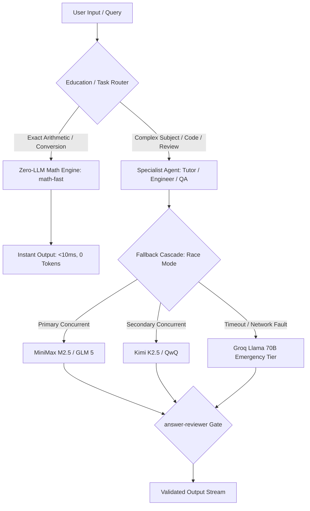

# OpenCode Agentic OS: Hybrid Deterministic & Multi-Agent Architecture

35 specialist AI agents for [OpenCode](https://opencode.ai) paired with deterministic zero-token compute offloading and hardware-aware deployment profiles.

Education tutors, senior engineers, DevOps automators, sales coaches, product managers, and QA specialists. Each agent operates under a focused role definition and strict system constraints. A zero-LLM math calculator resolves arithmetic and unit conversions deterministically in under 10ms with zero token consumption.


-green?style=flat-square)

---

## Core Systems Architecture



---

## Systems & Performance Highlights

- **Deterministic Zero-Token Compute (`math-fast.md`)**: Arithmetic (`sqrt`, `cbrt`, unit conversions) is intercepted via regex and evaluated deterministically, reducing response latency from ~2,000ms (LLM roundtrip) to **under 10ms with 0 token spend**.
- **Quality-Ranked Race Fallback**: Primary and parallel models execute concurrently (`race` mode), returning whichever verified response completes first. If upstream APIs throttle or timeout, execution cascades through Groq and OpenRouter emergency fallbacks.
- **Hardware-Aware Auto-Profiling (`ai/install.sh`)**: Installer script analyzes host physical memory and applies tailored inference topologies:
  - **24GB RAM (MacBook M4)**: Hybrid local (`qwen2.5-coder:14b`) + cloud fallback.
  - **16GB RAM (Desktop)**: Lean local (`qwen2.5-coder:7b`) + cloud fallback.
  - **8GB RAM (Mobile Laptop)**: Pure zero-footprint cloud tier.

---

## Agents Directory (35 Specialists)

### Education (8 agents)
| Agent | Role |
|:---|:---|
| `education-router` | Intent classification & tutor dispatching |
| `math-fast` | Instant calculator — zero LLM, exact values |
| `math-tutor-k12` | Algebra, geometry, arithmetic, foundations |
| `math-tutor-college` | Calculus, linear algebra, proofs, differential equations |
| `science-tutor` | Physics, chemistry, biology problem solving |
| `coding-tutor` | Syntax, algorithms, data structures, debugging |
| `test-prep-sat` | SAT/ACT standardized testing drills & test strategy |
| `answer-reviewer` | Quality gate — checks every tutor response for accuracy |

### Engineering (8 agents)
| Agent | Role |
|:---|:---|
| `senior-developer` | Full-stack architecture & implementation |
| `frontend-developer` | React, Vue, CSS architecture, web performance |
| `backend-architect` | System design, REST/gRPC APIs, database schema design |
| `code-reviewer` | Correctness, security audits, maintainability review |
| `devops-automator` | CI/CD pipelines, container orchestration, bash automation |
| `security-engineer` | Threat modeling, vulnerability scanning, secure design |
| `ai-engineer` | Model fine-tuning, inference serving, embedding pipelines |
| `database-optimizer` | Query indexing, execution plans, Postgres/MySQL tuning |

### Sales & Product (7 agents)
| Agent | Role |
|:---|:---|
| `deal-strategist` | MEDDPICC qualification and competitive positioning |
| `sales-engineer` | Technical discovery, demo architecture, POC scoping |
| `sales-coach` | Pipeline auditing, objection handling, pitch review |
| `account-strategist` | Account expansion, renewal planning, retention |
| `product-manager` | Discovery, roadmaps, technical user stories |
| `ui-designer` | Design systems, token hierarchies, visual UX |
| `ux-researcher` | Usability testing, workflow friction analysis |

### Delivery & Verification (12 agents)
| Agent | Role |
|:---|:---|
| `project-shepherd` | Cross-functional coordination, delivery timelines |
| `jira-workflow-steward`| Git workflow enforcement, traceable commit hygiene |
| `evidence-collector` | QA — screenshot-based bug reporting, visual verification |
| `reality-checker` | Production readiness gate — defaults to strict evaluation |
| `data-engineer` | Ingestion pipelines, schema management, data infrastructure |
| `analytics-reporter` | KPI dashboards, statistical tracking, metric analysis |
| `growth-hacker` | Funnel optimization and user onboarding telemetry |
| `content-creator` | Technical documentation and release communications |
| `seo-specialist` | Technical SEO, asset optimization, search hierarchy |
| `paid-media-auditor` | Multi-channel advertising spend auditing |
| `plan` | Master task decomposition orchestrator |
| `build` | Master builder orchestrator |

---

## Quickstart

### macOS & Linux
```bash
git clone https://github.com/thomas-m-brown/opencode-agentic-os.git
cd opencode-agentic-os
bash ai/install.sh
```

### Windows 11
```cmd
git clone https://github.com/thomas-m-brown/opencode-agentic-os.git
cd opencode-agentic-os
install-windows.bat
```

Test immediate execution in OpenCode:
```text
sqrt 196              → instant: 14 (<10ms)
cbrt -125             → instant: -5 (<10ms)
convert 5 miles to km → instant: 8.04672 (<10ms)
explain derivative    → college math tutor
python for loop       → coding tutor
```

---

## License

MIT
